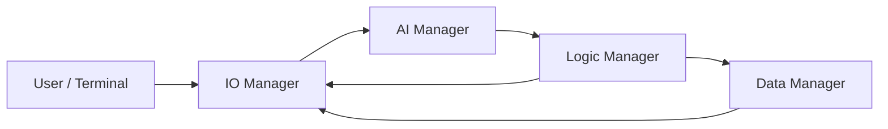

# Team 8 AI Hotel Recommendation System

A procedural Python CLI application developed for **SIT INF1103 – Team Project Framework, Phase 1: Procedural Foundation**.

The application helps users search for suitable hotels based on destination, budget, and natural-language preferences. User input is validated by the I/O layer, processed through Gemini in the AI layer, evaluated and ranked by deterministic business rules in the Logic layer, and persisted to JSON by the Data layer.

---

## Project Architecture

The project follows the required four-manager pipeline:

```text
User
  ↓
IO_manager.py
  ↓
ai_manager.py
  ↓
logic_manager.py
  ↓
data_manager.py
```



### Manager responsibilities

| Module | Responsibility |
|---|---|
| `IO_manager.py` | Collects and validates user input, displays menus, hotel results, saved records, and user-facing messages |
| `ai_manager.py` | Builds Gemini prompts, calls the API, parses JSON, validates the AI response, retries malformed responses, and logs API failures |
| `logic_manager.py` | Applies hotel business rules, filters unsuitable hotels, scores candidates, ranks them, and returns the top three |
| `data_manager.py` | Saves hotel search records to JSON, loads previous records, and queries saved searches |
| `app.py` | Coordinates the application flow between managers |

The codebase is designed to remain **100% procedural** for Phase 1.

---

## Main Features

- Structured CLI hotel search
- Destination, budget, email, and free-text preference input
- Input validation and safe re-prompting
- Gemini-powered generation of **10 hotel candidates**
- Structured JSON AI responses
- Support for zero, one, or multiple proximity preferences
- Distance information for requested locations
- Nearby food and activity suggestions
- AI response schema validation before downstream use
- AI model fallback and retry handling
- File-based AI error logging
- Deterministic hotel filtering and scoring
- Top-three hotel ranking
- Search history saved in JSON
- Search history lookup by email
- Admin view of saved records
- Automated Logic Manager tests that do not require a live API

---

## User Input

A hotel search collects:

```python
{
    "destination": "Singapore",
    "budget_min": 150,
    "budget_max": 300,
    "email_address": "user@example.com",
    "preferences": "near Marina Bay Sands, swimming pool and breakfast"
}
```

The I/O Manager validates the structured fields before they are passed downstream.

---

## AI Manager

The AI Manager is the core AI-processing layer.

### Main responsibilities

- `get_model()` – creates the Gemini client
- `build_prompt(record)` – converts validated user data into a strict hotel-recommendation prompt
- `call_api(prompt, client)` – calls Gemini with fallback models
- `parse_response(raw)` – extracts and parses JSON safely
- `validate_response(data)` – verifies the complete response schema
- `data_process(record, client)` – coordinates generation, validation, and one correction attempt

### AI model fallback order

```text
gemini-3.6-flash
        ↓
gemini-3.7-flash
        ↓
gemini-3.5-flash-lite
```

The AI Manager returns exactly **10 distinct hotel candidates** when processing succeeds.

### AI response structure

```json
{
  "proximity_preference": {
    "specified": true,
    "preferences": [
      "Marina Bay Sands"
    ]
  },
  "hotels": [
    {
      "name": "Example Hotel",
      "city": "Singapore",
      "country": "Singapore",
      "price_per_night_sgd": 250,
      "rating": 4.6,
      "amenities": [
        "Swimming Pool",
        "Free WiFi"
      ],
      "distance_to_preferences": [
        {
          "target": "Marina Bay Sands",
          "distance_m": 500
        }
      ],
      "nearby_food": [
        "Example Restaurant"
      ],
      "nearby_activities": [
        {
          "name": "Example Attraction",
          "distance_m": 700
        }
      ]
    }
  ]
}
```

If the user does not specify a place they want to stay near:

```json
{
  "proximity_preference": {
    "specified": false,
    "preferences": []
  }
}
```

and each hotel uses:

```json
"distance_to_preferences": []
```

### AI reliability handling

The AI Manager:

- rejects malformed JSON;
- checks required keys and data types;
- checks rating and distance ranges;
- rejects duplicate hotel names;
- validates proximity targets;
- attempts one corrected regeneration when AI output is malformed;
- tries fallback Gemini models for recoverable API failures;
- returns `None` instead of crashing if processing cannot continue;
- records warnings/errors in:

```text
logs/ai_api_errors.log
```

---

## Logic Manager

The Logic Manager acts as the deterministic domain brain of the system.

The main hotel-processing flow is:

```text
AI output
   ↓
build_requirements()
   ↓
validate_hotels()
   ↓
filter_hotels()
   ↓
calculate_score()
   ↓
rank_hotels()
   ↓
get_top_three()
   ↓
process_hotels()
```

### Hard filtering rules

A hotel may be rejected when:

- its nightly price is above the user's maximum budget;
- its customer review rating is below **3.5 / 5**;
- it is more than **2,000 m** from a location that the user explicitly requested to be near.

Missing information is handled using flags rather than causing the application to crash.

Examples include:

```text
rating_missing
rating_may_be_stars
amenities_missing
distance_unknown
```

### Scoring

The Logic Manager uses a score out of **100**.

Base scoring uses 90 points:

| Category | Base weight |
|---|---:|
| Customer review rating | 25 |
| Price | 20 |
| Location | 25 |
| User preferences / amenities | 20 |

A further **10-point top-match bonus** is available.

If a scoring category does not apply, its points are redistributed across the active categories so the score remains comparable out of 100.

### Multi-condition bonus rule

The 10-point bonus is awarded only when all applicable conditions are satisfied together:

- customer review rating is at least **4.5**;
- price is within the user's budget;
- the hotel is within **300 m** of every requested proximity target;
- every checkable requested amenity is present.

### Ranking

Hotels are ranked by:

1. highest score;
2. higher customer review rating;
3. lower nightly price;
4. normalized hotel name for deterministic ordering.

The system returns up to **three distinct hotels**.

---

## Data Manager

Search history is persisted in:

```text
datarecords.json
```

The current storage model groups search history by normalized email address.

Example:

```json
{
  "user@example.com": [
    [
      {
        "name": "Example Hotel",
        "city": "Singapore",
        "country": "Singapore",
        "price_per_night_sgd": 250
      }
    ]
  ]
}
```

### Data functions

- `save(record)` – loads existing records, appends a new search, and writes the updated JSON
- `load()` – returns all stored searches
- `query(record_email)` – returns searches associated with an email address
- `_read_file()` – safely reads the JSON file

The Data Manager treats a missing or completely empty data file as an empty data store instead of crashing.

---

## I/O Manager

All user-facing input and output is kept in `IO_manager.py`.

Current functionality includes:

- main menu
- destination input
- price-range input
- email validation
- optional hotel preferences
- hotel-result display
- previous-record lookup
- admin record display
- formatted nearby activities with distance values
- general user-facing messages

Example menu:

```text
1: Find a suitable hotel for your overseas travel needs!
2: View your previous hotel records
3: Admin login (NOT FOR USERS)
4: Quit
```

---

## Project Structure

```text
.
├── app.py
├── IO_manager.py
├── ai_manager.py
├── ai_filter.py
├── logic_manager.py
├── data_manager.py
├── test_logic_manager.py
├── datarecords.json
├── logs/
│   └── ai_api_errors.log
├── .env
├── .gitignore
├── Dockerfile
└── README.md
```

Runtime/private files should not be committed when they contain secrets or local data.

Recommended `.gitignore` entries:

```gitignore
__pycache__/
*.pyc
.env
logs/
datarecords.json
```

If the team intentionally wants to keep an empty starter `datarecords.json` in Git, remove it from `.gitignore` and initialize it with:

```json
{}
```

---

## Setup

### 1. Clone the repository

```bash
git clone <repository-url>
cd <repository-folder>
```

### 2. Install dependencies

```bash
pip install google-genai python-dotenv
```

If the repository contains `requirements.txt`, use:

```bash
pip install -r requirements.txt
```

### 3. Create `.env`

Create a `.env` file in the project root:

```env
GEMINI_API_KEY=your_api_key_here
```

Never commit the `.env` file.

---

## Running the Application

From the project root:

```bash
python app.py
```

The application displays the main menu and guides the user through a hotel search.

---

## Automated Tests

The automated Logic Manager test script uses **hardcoded AI responses** and does not connect to Gemini.

Run:

```bash
python test_logic_manager.py
```

The test suite covers areas such as:

- requirement construction;
- searches with and without proximity requirements;
- duplicate and invalid hotel removal;
- budget rejection;
- minimum-rating rejection;
- proximity rejection;
- missing-data flags;
- score calculation;
- score breakdown consistency;
- the multi-condition bonus rule;
- deterministic ranking;
- duplicate-safe top-three selection;
- full Logic Manager pipeline behavior;
- malformed AI input handling.

This allows the core business rules to be tested independently of the live API.

---

## Docker

The Phase 1 application is intended to run inside Docker.

Build the image from the repository root:

```bash
docker build -t team8-hotel-recommender .
```

Run it interactively while supplying the environment variables:

```bash
docker run --rm -it --env-file .env team8-hotel-recommender
```

The automated test script can also be executed inside the container:

```bash
python test_logic_manager.py
```

---

## Error Handling

| Scenario | Handling |
|---|---|
| Invalid terminal input | I/O Manager rejects and re-prompts |
| Gemini API unavailable | AI Manager logs the failure and returns safely |
| Recoverable Gemini failure | AI Manager tries fallback models |
| Malformed AI JSON | Response is rejected and one correction attempt is made |
| Invalid AI schema | Validation fails before Logic Manager uses the data |
| Missing `datarecords.json` | Data Manager treats it as an empty store |
| Empty `datarecords.json` | Data Manager treats it as `{}` |
| Corrupt JSON file | Error is logged and an empty data store is returned |
| Missing optional hotel data | Logic Manager flags the hotel where appropriate |

---

## Design Principles

### Procedural Phase 1

The project intentionally uses functions rather than classes.

### Separation of concerns

Each manager has a clear responsibility:

```text
I/O      → interaction and display
AI       → API interaction and structured AI output
Logic    → deterministic business decisions
Data     → persistence and retrieval
```

### AI as the core engine

Hotel candidates originate from the AI Manager and are validated before being used by downstream layers.

### Deterministic business logic

Final filtering, scoring, ranking, and top-three selection are performed by `logic_manager.py`, not by the AI prompt.

---

## Current Limitations

- Hotel availability and prices generated by the AI may change in the real world.
- Distance values currently depend on structured AI output and are not a substitute for a dedicated mapping/distance API.
- The application currently uses flat-file JSON persistence rather than a database.
- The admin login is suitable for a project prototype and should use stronger credential management in a production system.
- Final production-quality booking links and live room availability are outside the current Phase 1 scope.

---

## Phase 1 Goal

This project demonstrates a complete procedural application architecture where:

```text
validated user input
        ↓
structured AI processing
        ↓
deterministic business rules
        ↓
persistent searchable records
```

The design provides a clear foundation for the object-oriented refactor required in Phase 2.
