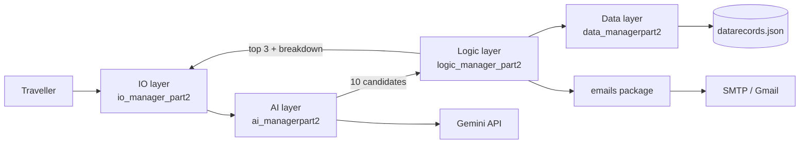
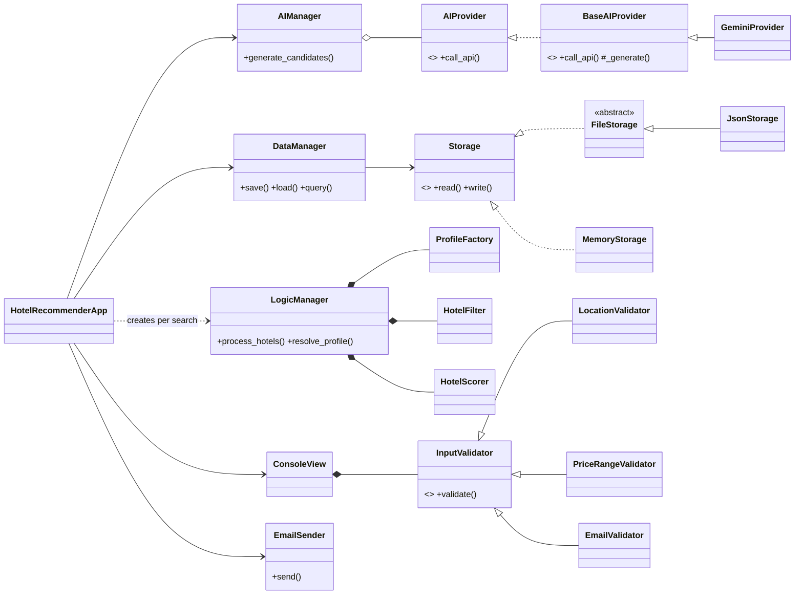

# Team 8 - AI Hotel Recommendation System (Phase 2: Object-Oriented Design)

SIT **INF1103** Team Project, Phase 2. The Phase 1 procedural program has been redesigned with object-oriented programming (OOP) and SOLID principles, and extended with **Traveller Priority Profiles**, **email notification** and a **web GUI**.

A traveller enters a destination, a nightly budget (SGD), an email address and optional free-text preferences, then chooses a priority profile. The system asks Gemini for 10 candidate hotels, applies mandatory business rules, scores the survivors out of 100, shows the top 3 with a score breakdown, saves them to JSON and emails them.

---

## What is new in Phase 2

| Area | Change |
|---|---|
| OOP redesign | Four procedural modules became four packages of small classes (one class per file), joined by interfaces and dependency injection |
| **Traveller Priority Profiles** (new feature) | Balanced, Budget focused, Quality focused or Customisation; each changes the scoring weights |
| **Email notification** (advanced feature) | Top 3 hotels are emailed (plain text + HTML) over SMTP |
| AI layer | Provider abstraction, model fallback, one correction retry, error log |
| Saved records | Look up by email and by (partial) country, e.g. `singa` |
| Front ends | Console app (`app.py`) and NiceGUI web app (`gui_app.py`) share the same four layers |
| Storage | `JsonStorage` for files, `MemoryStorage` for demos and tests (`DATA_STORAGE=memory`) |
| Quality | `unittest` suite in `tests/` that needs no live API, GitHub Actions CI, Docker image |

---

## Architecture

Four layers, each a package. Layers exchange **plain dictionaries**, so no layer depends on another layer's classes.



`app.py` (console) and `gui/` (web) are the **composition roots**: they create the objects and pass them to each other.

| Layer / package | Responsibility | Main classes |
|---|---|---|
| IO - `io_manager_part2/` | All input, validation and display. No business rules | `ConsoleView`, `InputReader`, `InputValidator` and its subclasses `LocationValidator`, `PriceRangeValidator`, `EmailValidator`, `WeightValidator`, `CountrySearchValidator` |
| AI - `ai_managerpart2/` | Build prompt, call Gemini, parse, validate, retry, log | `AIManager`, `AIManagerFactory`, `AIProvider` / `BaseAIProvider` / `GeminiProvider`, `HotelPromptBuilder`, `AIResponseParser`, `HotelResponseValidator`, `AIErrorLogger`, `AIConfig` |
| Logic - `logic_manager_part2/` | Filter, score and rank hotels; resolve profiles. No file, network or print access | `LogicManager`, `ProfileFactory`, `ScoringConfig`, `Requirements`, `HotelFilter`, `HotelScorer`, `Hotel` |
| Data - `data_managerpart2/` | Persist and query records | `DataManager`, `Storage` / `FileStorage` / `JsonStorage` / `MemoryStorage`, `UserRecord`, `Search`, `Hotel` |
| Email - `emails/` | Compose and send the recommendation email | `EmailSender`, `RecommendationEmail` |
| GUI - `gui/` | NiceGUI pages and the bridge to the layers | `GuiController`, `PageRegistry`, `BasePage` and six pages, `components/` |

### Class diagram (core relationships)



Legend: `<|--` inheritance, `<|..` implements an interface, `*--` composition, `o--` aggregation, `-->` association, `..>` dependency.

---

## OOP concepts and where to find them

| Concept | Example in the code |
|---|---|
| **Encapsulation** | Private state with name mangling: `DataManager.__storage`, `UserRecord.__email`, `EmailSender.__app_password`. `Requirements` exposes results through read-only `@property`. `Search` returns copies of its hotels |
| **Abstract class** | `FileStorage` (shared read/write error handling; subclasses supply `_parse` / `_format`), `BaseAIProvider` (shared fallback loop; subclasses supply `_generate`), `ResponseValidator`, `InputValidator` |
| **Inheritance** | `JsonStorage` -> `FileStorage` -> `Storage`; `GeminiProvider` -> `BaseAIProvider` -> `AIProvider`; the five validators -> `InputValidator`; `RecoverableProviderError` and `FatalProviderError` -> `AIError` |
| **Interface** | Pure contracts: `Storage`, `AIProvider`, `PromptBuilder`, `ResponseParser`, `AILogger` |
| **Association** | `DataManager` uses a `Storage` it was given; `HotelRecommenderApp` uses `ConsoleView`, `AIManager`, `DataManager`, `EmailSender` |
| **Aggregation** | `AIManager` receives its provider, prompt builder, parser, validator and logger from `AIManagerFactory`; `UserRecord` groups `Search` objects built elsewhere |
| **Composition** | `ConsoleView` creates its `InputReader` and validators; `Search` creates its own `Hotel` objects; `LogicManager` creates `Requirements`, `HotelFilter`, `HotelScorer` for each search |
| **Polymorphism** | `DataManager` calls `read()` / `write()` on JSON or memory storage without checking the type; `ConsoleView` calls `validate()` on any validator; `BaseAIProvider` calls the subclass `_generate()` |

## SOLID

| Principle | How it is applied |
|---|---|
| **S** - Single responsibility | `Requirements` allocates points, `HotelFilter` applies the mandatory rules, `HotelScorer` scores and ranks, `ProfileFactory` owns profile weights, `LogicManager` only sequences them. Validation, storage, email and AI calls each have their own class |
| **O** - Open/closed | New profile: add an entry to `ProfileFactory.PRESETS`. New AI vendor: subclass `BaseAIProvider`. New storage: subclass `Storage`. New page: subclass `BasePage` and add it to the list given to `PageRegistry`. No existing manager is edited |
| **L** - Liskov substitution | Every `Storage` returns `{}` for a bad read and `True/False` for a write; every `AIProvider` returns text or `None` and never raises. Tests swap in memory, failing and scripted implementations |
| **I** - Interface segregation | Interfaces are small (`Storage` has 2 methods, `ResponseParser` 1) |
| **D** - Dependency inversion | `AIManager` and `DataManager` depend on abstractions; `AIManagerFactory` and the composition roots choose the concrete classes |

---

## Business rules (Logic layer)

```
AI output -> build requirements -> validate hotels -> filter -> score -> rank -> top 3
```

**Mandatory rules** (a hotel is rejected if):
- its nightly price is above the traveller's maximum budget;
- its review rating is below **3.5 / 5**;
- it is more than **2,000 m** from a place the traveller asked to be near.

Missing information is flagged (`rating_missing`, `amenities_missing`, `distance_unknown`, `rating_may_be_stars`) instead of crashing.

**Scoring** is out of 100: **90 base points** across five criteria plus a **10-point top-match bonus** that needs all of: rating >= 4.5, price within budget, within 300 m of every requested place, every checkable amenity present. The breakdown is shown with each result.

**Ranking:** highest score, then higher rating, then lower price, then hotel name.

### Traveller Priority Profiles

Points are given to rating / price / location / amenities / bonus:

| Option | Profile | Rating | Price | Location | Amenities | Bonus |
|---|---|---:|---:|---:|---:|---:|
| 1 | Balanced | 25 | 20 | 25 | 20 | 10 |
| 2 | Budget focused | 15 | 45 | 20 | 10 | 10 |
| 3 | Quality focused | 40 | 10 | 20 | 20 | 10 |
| 4 | Customisation | you choose | | | | total must be 100 |

- **Presets:** if location or amenities cannot be scored (no place or checkable amenity named), their points are redistributed so the total stays 100.
- **Customisation:** points are **not** redistributed; categories that cannot apply are fixed at 0, and a total other than 100 is rejected and asked again.
- Classes: `ConsoleView` and `WeightValidator` (input), `ProfileFactory` and `LogicManager.resolve_profile` (rules), `Requirements` and `HotelScorer` (use), `GuiController` and the search page (web).

---

## AI layer

`AIManager.generate_candidates(record)` returns a dictionary of 10 distinct hotels, or `None`.

1. `HotelPromptBuilder` builds a strict JSON-only prompt.
2. `BaseAIProvider` calls `GeminiProvider` with **model fallback**: `gemini-3.5-flash-lite` -> `gemini-3.7-flash` -> `gemini-3.6-flash`. Network, quota, timeout and server errors raise `RecoverableProviderError` (try the next model); other errors raise `FatalProviderError` (stop).
3. `AIResponseParser` strips code fences and parses the JSON.
4. `HotelResponseValidator` checks the schema, ranges, duplicates and proximity targets.
5. If the answer is invalid, **one** correction request lists the errors; if still invalid, the result is `None`.
6. Failures are written to `logs/ai_api_errors.log`. The AI layer never raises to the caller.

Expected hotel shape: `name`, `city`, `country`, `price_per_night_sgd`, `rating`, `amenities[]`, `distance_to_preferences[{target, distance_m}]`, `nearby_food[]`, `nearby_activities[{name, distance_m}]`.

## Data layer

Records are stored in `datarecords.json`, keyed by normalised email (trimmed, lower case). Each email holds a list of searches; each search is the list of the (up to 3) hotels returned:

```json
{
    "user@example.com": [
        [ { "name": "Hotel A", "city": "Singapore", "country": "Singapore",
            "price_per_night_sgd": 170.0, "rating": 4.2,
            "amenities": ["Free Wi-Fi"], "distance_to_preferences": [],
            "nearby_food": ["Food court"],
            "nearby_activities": [ { "name": "Temple", "distance_m": 250 } ] },
          { "name": "Hotel B" }, { "name": "Hotel C" } ]
    ]
}
```

`DataManager` provides `save(record)`, `load()`, `query(email)` and `query_by_country(email, text)`. A missing, empty or corrupt file is treated as "no records"; entries of the wrong type, empty searches and nameless hotels are skipped. At runtime the data is rebuilt as `UserRecord` -> `Search` -> `Hotel`.

## Email

`EmailSender.send(to_address, subject, body, html_body=None)` uses SMTP over SSL (`smtp.gmail.com:465`, 15 s timeout) and **returns `True`/`False`, never raising**. `RecommendationEmail` builds the subject, plain-text body and HTML body. Without credentials no connection is attempted.

---

## Exception handling summary

| Situation | Handling |
|---|---|
| Invalid input | Validator returns `(False, message)`; the console re-prompts, the GUI shows a message |
| Gemini unavailable, quota, timeout | Next model; all fail -> "service unavailable", nothing saved or emailed |
| Malformed AI output | Parse/validate, one correction request, then give up safely |
| Unusable hotel data | Dropped or flagged, never a crash |
| Invalid profile weights | `ValueError` -> re-ask (console) or message (GUI) |
| No hotel passes the rules | "No hotels matched", nothing saved |
| Records file missing or corrupt | Treated as empty; the next save writes a valid file |
| Write failure or email failure | `write()` / `send()` return `False` and log the reason |

---

## Setup and running

Requires Python 3.11 or newer.

```bash
python -m venv .venv
.venv\Scripts\activate          # Windows   (macOS/Linux: source .venv/bin/activate)
pip install -r requirements.txt
```

Create `.env` in the project root (never commit it):

```
GEMINI_API_KEY=your-gemini-key
EMAIL_ADDRESS=your-gmail-address@gmail.com
EMAIL_APP_PASSWORD=your-16-character-gmail-app-password
DATA_STORAGE=json
```

`EMAIL_*` are optional (no email is sent without them). `DATA_STORAGE=memory` keeps records in RAM only.

| Run | Command |
|---|---|
| Console app | `python app.py` |
| Web GUI | `python gui_app.py`, then open http://localhost:8080 |
| Docker (console) | `docker build -t hotel-app .` then `docker run -it --rm --env-file .env -v hotel-data:/data hotel-app` |
| Docker (web) | `docker run --rm -p 8080:8080 --env-file .env -v hotel-data:/data hotel-app python /app/gui_app.py` |

Run commands from the project root. `gui/gui_controller.py` is a library class, not an entry point.
The admin menu uses demo credentials `team8` / `12345`.

## Tests

```bash
python -m unittest discover -s tests -v
```

`tests/` holds `test_io_manager.py`, `test_logic_manager.py`, `test_ai_manager.py` and `test_data_manager.py`. They use scripted AI answers and in-memory or temporary storage, so they need **no API key, internet or email account**. The same command runs in Docker (`docker run --rm hotel-app python -m unittest discover -s /app/tests -v`) and in GitHub Actions (`.github/workflows/ci.yml`: syntax check, import check of both apps, unit tests).

## Project structure

```text
.
├── app.py                    console app (composition root)
├── gui_app.py                web app entry point
├── ai_managerpart2/          AI layer
├── io_manager_part2/         IO layer
├── logic_manager_part2/      Logic layer
├── data_managerpart2/        Data layer
├── emails/                   EmailSender, RecommendationEmail
├── gui/                      GuiController, pages/, components/
├── tests/                    unit tests
├── logs/                     ai_api_errors.log (generated)
├── datarecords.json          saved searches (generated)
├── Dockerfile, requirements.txt, .github/workflows/ci.yml
└── .env                      private settings (not committed)
```

Do not commit `.env`, `datarecords.json` (real email addresses) or `logs/`.

## Known limitations

- In the console app, Ctrl-C / Ctrl-D (or closed input) prints a goodbye message but the menu loop continues instead of exiting.
- The result of `DataManager.save()` is not checked, so "saved successfully" can appear even if writing failed (the email result *is* reported).
- With Customisation, location/amenity points cannot be earned when the AI finds no place to measure against.
- The GUI validates less strictly than the console.
- Admin credentials are fixed demo values.